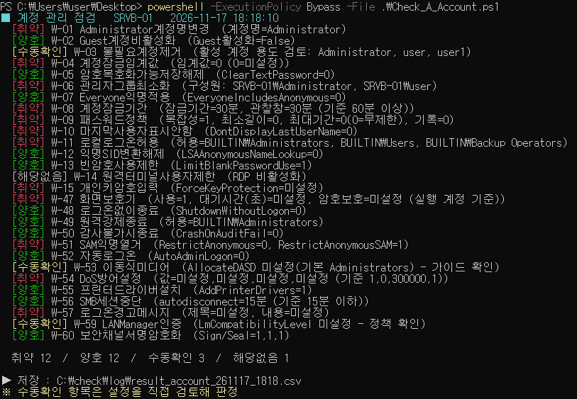
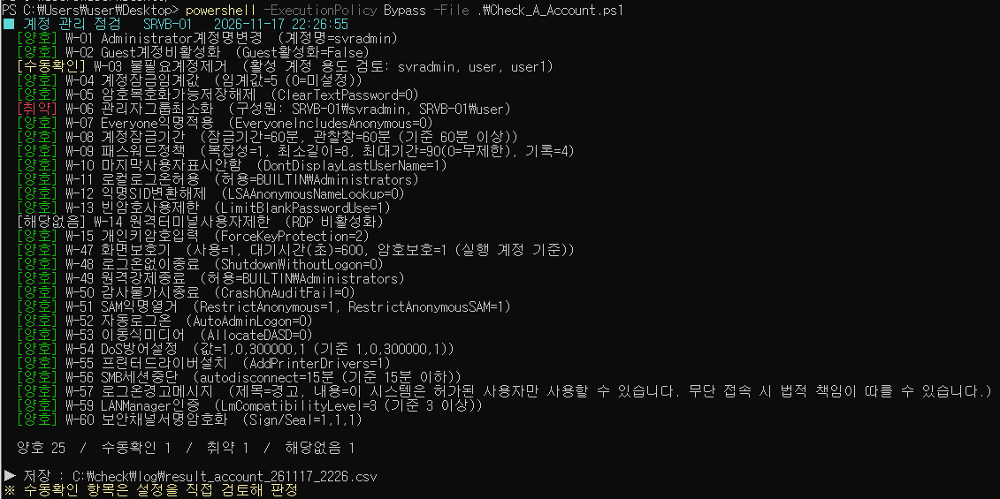
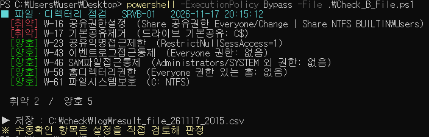
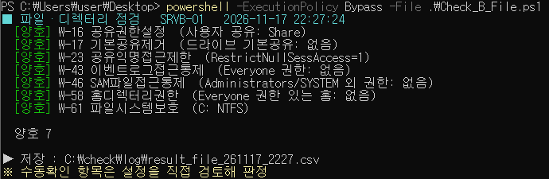
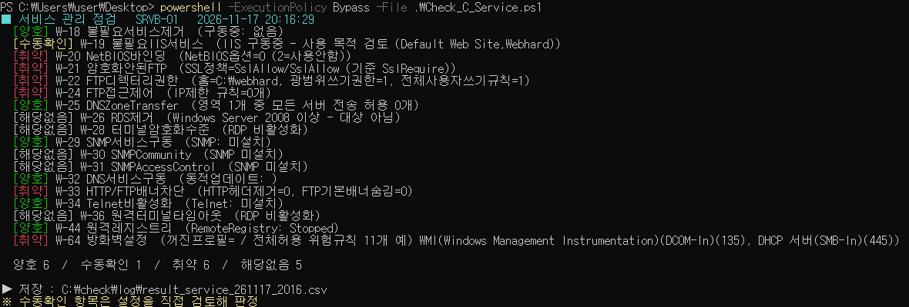
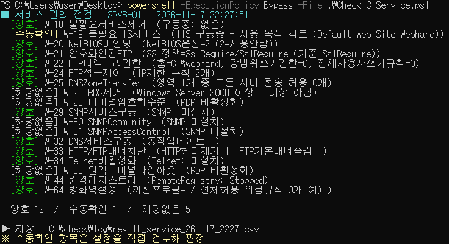
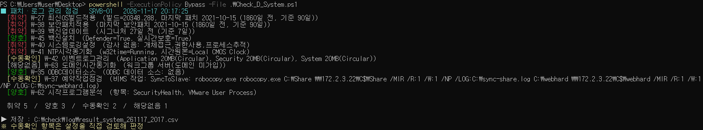
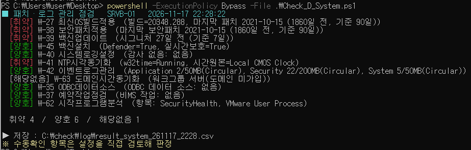

# Windows Server 2022 취약점 점검 및 조치 (KISA 주통기 W-01 ~ W-64)

KISA 주요정보통신기반시설 기술적 취약점 분석, 평가 가이드의 Windows 서버 64개 항목을 PowerShell로 점검하고, 취약 항목을 조치한 결과와 스크립트를 정리한 문서입니다. 점검 스크립트는 설정을 바꾸지 않고 결과만 출력하며, 조치 스크립트는 백업 후 항목별로 확인하고 적용합니다.

## 1. 점검 개요

| 항목 | 내용 |
|---|---|
| 대상 | Windows Server 2022 (SRVB-01), VMware ESXi 위의 VM, 워크그룹 |
| 역할 | IIS(웹, FTP), DNS, DHCP, 파일 공유, NLB |
| 네트워크 | DMZ 대역 172.2.3.0/24 |
| 점검 기준 | KISA 주통기 Windows 64개 항목 (W-01 ~ W-64) |
| 점검 방법 | PowerShell 5.1 점검 스크립트 4종(A~D), 조치 전과 조치 후에 같은 스크립트로 재점검 |

## 2. 점검 결과 요약

| 분야 | 점검 | 양호 | 취약 | 해당없음 |
|---|---|---|---|---|
| 계정 관리 | 14 | 6 | 7 | 1 |
| 서비스 관리 | 23 | 9 | 9 | 5 |
| 패치 관리 | 2 | 0 | 2 | 0 |
| 로그 관리 | 4 | 1 | 3 | 0 |
| 보안 관리 | 21 | 12 | 8 | 1 |
| **합계** | **64** | **28** | **29** | **7** |

위 표는 **조치 전** 기준입니다. 취약 29건 중 24건을 조치 완료하고 5건(W-06, W-27, W-38, W-39, W-41)은 권고로 처리해, 조치 후에는 **양호 52건, 취약(권고) 5건, 해당없음 7건**이 되었습니다.

## 3. 점검 스크립트와 조치 전후 결과

점검 항목은 성격이 비슷한 것끼리 4개 스크립트로 나누었습니다. 판정은 양호(초록), 취약(빨강), 수동확인(노랑), 해당없음(회색)으로 색을 구분해 한 줄씩 출력됩니다.

### A. 계정, 로컬 보안 정책  (`Check-A-Account.ps1`)

조치 전 14건(수동확인 W-53, W-59 취약 판정) -> 조치 후 W-06만 권고로 남음

| 조치 전 | 조치 후 |
|---|---|
|  |  |

| 코드 | 점검 항목 | 위험도 | 조치 전 현황 | 조치 내용 | 결과 |
|---|---|---|---|---|---|
| W-01 | Administrator 계정 이름 변경 등 보안성 강화 | 상 | 관리자 계정명이 기본값(Administrator) 그대로 사용 중 | Rename-LocalUser로 Administrator -> svradmin 변경 (잔여 작업 SyncToSlave 비활성화 후 적용, 이후 관리자 로그인 이름은 svradmin) | 조치완료 |
| W-04 | 계정 잠금 임계값 설정 | 상 | 잠금 임계값 0 (미설정, net accounts) | net accounts /lockoutthreshold:5 (5회 실패 시 계정 잠금) | 조치완료 |
| W-06 | 관리자 그룹에 최소한의 사용자 포함 | 상 | Administrators 구성원: Administrator, user (일반 작업 계정 user가 관리자 그룹에 포함) | (권고) 일반 작업 계정(user)을 관리자 그룹에서 제외하고 관리자 전용 계정만 유지. 현재 user가 점검, 조치를 수행하는 계정이라 작업 종료 후 적용 권고. | 권고 |
| W-08 | 계정 잠금 기간 설정 | 중 | 잠금 기간 30분, 재설정 시간 30분 (잠금 임계값 미설정 상태) | net accounts /lockoutduration:60 /lockoutwindow:60 | 조치완료 |
| W-09 | 패스워드 관리정책 설정 | 상 | 최소 길이 0, 암호 기록 없음, 최대 사용기간 무제한 (복잡성만 사용). user 계정은 암호가 필수가 아님(PasswordRequired=False) | net accounts /minpwlen:8 /maxpwage:90 /uniquepw:4 적용, user 계정에 암호를 설정하고 암호 필수로 지정 | 조치완료 |
| W-10 | 마지막 사용자 이름 표시 안 함 | 중 | DontDisplayLastUserName=0 (로그온 화면에 이전 사용자 표시) | 레지스트리 DontDisplayLastUserName=1 설정 | 조치완료 |
| W-11 | 로컬 로그온 허용 | 중 | 로컬 로그온 허용 대상: Administrators, Users, Backup Operators | 로컬 로그온 허용(SeInteractiveLogonRight)을 Administrators로 제한 (secedit 적용, 재부팅 후 반영) | 조치완료 |
| W-15 | 사용자 개인키 사용 시 암호 입력 | 상 | ForceKeyProtection 미설정 | 레지스트리 ForceKeyProtection=2 설정 | 조치완료 |
| W-47 | 화면보호기 설정 | 상 | 화면보호기 대기시간, 암호 보호 미설정 (실행 계정 user 기준) | 정책 경로에 화면보호기 사용, 대기 600초, 암호 보호 설정 | 조치완료 |
| W-51 | SAM 계정과 공유의 익명 열거 허용 안 함 | 상 | RestrictAnonymous=0 (RestrictAnonymousSAM=1) | 레지스트리 RestrictAnonymous=1 설정 | 조치완료 |
| W-53 | 이동식 미디어 포맷 및 꺼내기 허용 | 상 | AllocateDASD 미설정 (정책이 명시적으로 설정되어 있지 않음) | 레지스트리 AllocateDASD=0 설정 | 조치완료 |
| W-54 | Dos공격 방어 레지스트리 설정 | 중 | 4개 값 모두 미설정 | 4개 값을 기준대로 설정 (일부는 재부팅 후 적용) | 조치완료 |
| W-57 | 로그온 시 경고 메시지 설정 | 하 | 경고 메시지 제목(LegalNoticeCaption), 내용(LegalNoticeText) 모두 비어 있음 | 경고 제목('경고')과 내용 설정 | 조치완료 |
| W-59 | LAN Manager 인증 수준 | 중 | LmCompatibilityLevel 미설정 | LmCompatibilityLevel=3 설정 (기본 동작과 같아 서비스 영향 없음) | 조치완료 |

### B. 공유, 파일 권한  (`Check-B-File.ps1`)

조치 전 2건 -> 조치 후 전체 양호

| 조치 전 | 조치 후 |
|---|---|
|  |  |

| 코드 | 점검 항목 | 위험도 | 조치 전 현황 | 조치 내용 | 결과 |
|---|---|---|---|---|---|
| W-16 | 공유 권한 및 사용자 그룹 설정 | 상 | Share 공유 권한 Everyone: 변경(Change), NTFS(C:\Share) BUILTIN\Users: 수정(Modify) | Share의 Everyone 제거 -> 인증된 사용자 읽기 허용, C:\Share의 Users 수정 권한 제거 | 조치완료 |
| W-17 | 하드디스크 기본 공유 제거 | 상 | 기본 공유 C$, ADMIN$, IPC$ 존재 (AutoShareServer 기본값) | AutoShareServer=0 설정, C$ 공유 삭제 | 조치완료 |

### C. 네트워크, 서비스  (`Check-C-Service.ps1`)

조치 전 6건(재부팅 후 W-44 추가, 총 7건) -> 조치 후 전체 양호

| 조치 전 | 조치 후 |
|---|---|
|  |  |

| 코드 | 점검 항목 | 위험도 | 조치 전 현황 | 조치 내용 | 결과 |
|---|---|---|---|---|---|
| W-20 | NetBIOS 바인딩 서비스 구동 점검 | 상 | NetBIOS 옵션=0(기본값), TCP 139, UDP 137/138 수신 중 | 모든 IP 사용 어댑터에서 NetBIOS over TCP/IP 사용 안 함으로 설정 (재부팅 후 적용) | 조치완료 |
| W-21 | 암호화되지 않는 FTP 서비스 비활성화 | 상 | 21번 포트 FTP(IIS, Webhard 사이트) SSL 정책이 SslAllow - 평문 접속 허용, FTPS 미강제 | 자체 서명 인증서를 생성해 FTP SSL 바인딩, 제어, 데이터 채널 모두 SslRequire 설정 (클라이언트는 FTPS 명시적 TLS 필요) | 조치완료 |
| W-22 | FTP 디렉터리 접근권한 설정 | 상 | C:\webhard에 BUILTIN\Users 수정 권한, FTP 권한 규칙이 모든 사용자(*)에게 읽기, 쓰기 허용. FTP 접속 기록상 사용 계정은 user1 | FTPUsers 그룹(user1)을 생성해 해당 그룹만 읽기, 쓰기 허용, C:\webhard의 Users 수정 권한 제거 | 조치완료 |
| W-24 | FTP 접근 제어 설정 | 상 | FTP IP 제한 규칙 없음 (FTP 접속 기록상 접속 IP는 모두 랜 대역 172.2.3.x) | 허용 IP를 172.2.3.0/24와 127.0.0.1로 제한, 그 외 접속 거부 | 조치완료 |
| W-33 | HTTP/FTP/SMTP 배너 차단 | 하 | HTTP Server 헤더 제거 설정 없음, FTP 기본 배너 숨김 없음 | IIS removeServerHeader 설정, FTP suppressDefaultBanner 설정 (appcmd) | 조치완료 |
| W-44 | 원격으로 액세스할 수 있는 레지스트리 경로 | 상 | 최초 점검에서는 중지(양호)였으나 시작 유형이 자동이라 재부팅 후 서비스가 Running으로 확인됨 | 서비스 중지 및 시작 유형을 사용 안 함으로 설정 | 조치완료 |
| W-64 | 윈도우 방화벽 설정 | 중 | 방화벽은 사용 중이나 원격 주소 Any로 열린 위험 규칙 11개 (예: WMI DCOM 135, DHCP SMB 445, FTP 수동 포트 범위) | 해당 규칙 12개의 원격 주소를 LocalSubnet(같은 대역)으로 제한 | 조치완료 |

### D. 패치, 로그, 시스템  (`Check-D-System.ps1`)

조치 전 6건 -> 조치 후 W-27, 38, 39, 41 권고(4건)

| 조치 전 | 조치 후 |
|---|---|
|  |  |

| 코드 | 점검 항목 | 위험도 | 조치 전 현황 | 조치 내용 | 결과 |
|---|---|---|---|---|---|
| W-27 | 최신 Windows OS Build 버전 적용 | 상 | 빌드 20348.288, 마지막 패치 2021-10-15 (약 1,860일 경과) | (계획된 변경 권고) 외부 접근 제한(FTP, SMB를 내부 대역 172.2.3.0/24로 한정, W-24, W-64)으로 노출 위험을 이미 낮춘 상태이며, 업데이트 적용 시 IIS, FTP 등 운영 서비스와의 호환성 문제가 우려되어 조치하지 않음. 호환성 검증과 롤백 계획 수립 후 최신 누적 업데이트(.msu, wusa) 적용 권고. | 권고 |
| W-38 | 주기적 보안 패치 및 벤더 권고사항 적용 | 상 | 마지막 보안 패치 2021-10-15 (약 1,860일 경과), Windows Update 이력은 Defender 정의 업데이트뿐 | (계획된 변경 권고) W-27과 동일. 외부 접근 제한으로 노출을 줄인 상태에서 호환성 검증 후 보안 패치를 적용하고, 패치 관리 절차와 업데이트 정책(WSUS 또는 자동 업데이트)을 수립 권고. | 권고 |
| W-39 | 백신 프로그램 업데이트 | 상 | Defender 시그니처 마지막 갱신 후 27일 경과 (실시간 보호는 사용 중) | (계획된 변경 권고) Microsoft 보안 인텔리전스 오프라인 파일(mpam-fe.exe)을 정기적으로 적용하는 절차 수립 권고. 실시간 보호는 동작 중. | 권고 |
| W-40 | 정책에 따른 시스템 로깅 설정 | 중 | 감사 없음: 개체 접근, 권한 사용, 프로세스 추적 | auditpol로 8개 범주를 성공/실패 감사로 설정 (로그 증가에 대비해 W-42와 함께 처리) | 조치완료 |
| W-41 | NTP 및 시각 동기화 설정 | 중 | NtpServer=time.windows.com으로 설정되어 있으나 동기화되지 않음 (시간 원본=Local CMOS Clock) | (조치 예정) 랩 내부 NTP 서버를 지정해 동기화: w32tm /config /manualpeerlist:"<NTP서버 IP>" /syncfromflags:manual /update 후 w32tm /resync. VMware Tools 시간 동기화는 점검 기준의 시간 원본으로 인식되지 않음. | 권고 |
| W-42 | 이벤트 로그 관리 설정 | 하 | Application, Security, System 각 20MB, Security 로그가 100% 사용되어 덮어쓰는 상태 | Security 200MB, Application, System 50MB로 확대 (wevtutil) | 조치완료 |

## 4. 권고 처리 항목 (5건)

| 코드 | 점검 항목 | 위험도 | 미조치 사유, 현재 상태 | 권고 조치 | 권고 기한 |
|---|---|---|---|---|---|
| W-27, 38 | 보안 패치 미적용 | 상 | 마지막 패치 2021-10-15(약 1,860일 경과). 업데이트 시 서비스 호환성 우려로 미조치. 외부 접근 제한(W-24, W-64)으로 노출 완화 | 호환성 검증, 롤백 계획 수립 후 최신 누적 업데이트 적용, 패치 관리 체계(WSUS 등) 수립 | 즉시 |
| W-39 | 백신 업데이트 | 상 | Defender 시그니처 27일 경과, 실시간 보호는 동작 중. 정기 갱신 절차, 담당자 미지정 | 오프라인 정의 파일(mpam-fe.exe)을 정기 적용하는 절차 수립 | 1개월 |
| W-06 | 관리자 그룹 구성원 | 상 | 점검, 조치 작업 계정(user)이 Administrators에 포함 | 작업 종료 후 user 계정을 관리자 그룹에서 제외 | 점검 종료 즉시 |
| W-41 | NTP 시각 동기화 | 중 | 시간 원본 미지정, Local CMOS Clock으로 동작(동기화 안 됨) | 내부 NTP 서버를 지정해 w32tm으로 동기화 (향후 조치 예정) | 3개월 |

W-41은 내부 NTP 서버가 정해지면 아래 명령으로 조치합니다.

```powershell
w32tm /config /manualpeerlist:"<NTP서버 IP>" /syncfromflags:manual /update
w32tm /resync
w32tm /query /source
```

## 5. 수동확인 항목과 오탐 검증

- **수동확인 판정**: 스크립트가 판단하지 못한 W-03(불필요 계정)은 활성 계정 3개 모두 최근 로그인 이력이 있어 양호, W-19(불필요 IIS 서비스)는 NLB 포트 규칙(21, 80)으로 운영 중이라 양호, W-37(예약 작업)은 삭제된 슬레이브로 동기화하던 잔여 작업(SyncToSlave)이라 의심 명령이 아니어서 양호로 판정하고 정리 차원에서 작업을 비활성화했습니다.
- **정책 미설정 판정**: W-53, W-59는 정책이 명시적으로 설정되어 있지 않아 취약으로 판정하고 기본 동작과 같은 값으로 설정했습니다.
- **W-44 상태 변화**: 최초 점검에서는 서비스가 중지되어 양호였으나 시작 유형이 자동이라 재부팅 후 Running이 되어, 취약으로 조치했습니다.
- **스크립트 보완**: W-42는 "각 로그 10MB 이상, 사용률 90% 미만"으로 기준을 보완했고, W-47은 정책 경로의 값을 우선 조회하도록 고쳐서 조치 후 재점검에 사용했습니다. W-47은 계정마다 설정이 따로 저장되므로 점검하는 계정에 따라 결과가 다를 수 있습니다.

## 6. 종합 의견

- **공통 취약 패턴**: 설치 시 기본 설정 방치. 암호 길이, 계정 잠금 정책 미설정, 기본 공유(C$), Everyone 권한, 평문 FTP, 감사 정책, 이벤트 로그 크기 기본값 등 OS 기본값이 보안 기준보다 느슨했습니다.
- **서비스 영향 고려**: 정책, 레지스트리, 로그 설정 등 영향이 작은 항목(Fix-1, 16건)과 계정명, 공유, FTP, 방화벽 등 영향 가능 항목(Fix-2, 8건)을 나누어 단계적으로 조치했습니다. 조치 전 설정은 백업하고 항목별로 실행 여부를 확인했습니다.
- **재현성**: 같은 점검 스크립트로 조치 전후를 재점검해 개선 효과를 확인했습니다.

## 7. 스크립트 사용법

```
(저장소 루트)
  점검 스크립트/   Check-A-Account.ps1, Check-B-File.ps1, Check-C-Service.ps1, Check-D-System.ps1
  조치 스크립트/   Fix-1-Safe.ps1, Fix-2-Service.ps1
  images/          조치 전, 조치 후 점검 화면
```

1. 스크립트를 서버에 복사합니다. 파일은 **UTF-8 (BOM)** 이어야 합니다. BOM이 없으면 한글이 깨지고 구문 오류가 납니다.
2. 관리자 권한 PowerShell에서 실행합니다.

```powershell
powershell -ExecutionPolicy Bypass -File .\Check-A-Account.ps1
```

3. 결과는 화면에 색으로 표시되고 `C:\check\log\result_<분류>_<날짜>.csv`로도 저장됩니다.

| 구분 | 파일 | 내용 |
|---|---|---|
| 점검 | Check-A-Account | 계정, 로컬 보안 정책 (W-01 ~ W-15, W-47 ~ W-57, W-59, W-60) |
| 점검 | Check-B-File | 공유, 파일 권한 (W-16, 17, 23, 43, 46, 58, 61) |
| 점검 | Check-C-Service | 네트워크, 서비스 (W-18 ~ W-22, 24 ~ 26, 28 ~ 34, 36, 44, 64) |
| 점검 | Check-D-System | 패치, 로그, 시스템 (W-27, 35, 37 ~ 42, 45, 62, 63) |
| 조치 | Fix-1-Safe | 서비스 영향이 작은 항목 16건. 실행 전 설정을 `C:\check\backup`에 백업 |
| 조치 | Fix-2-Service | 서비스 영향 확인이 필요한 항목 8건과 잔여 작업 1건. 항목마다 y/n 확인, 백업은 `C:\check\backup2` |

Fix-2-Service 상단의 `$site`(FTP 사이트 이름)와 `$subnet`(허용할 대역)은 환경에 맞게 바꿔서 사용합니다.

## 8. 주의

- 운영 서버에서는 점검 스크립트로 현황을 먼저 확인하고, 조치 스크립트는 영향을 검토한 뒤 실행하세요. 일부 조치는 재부팅이 필요합니다.
- 스크립트에 암호나 키는 들어 있지 않습니다. 서버 이름, IP 대역, 계정 이름은 점검 환경의 값입니다.